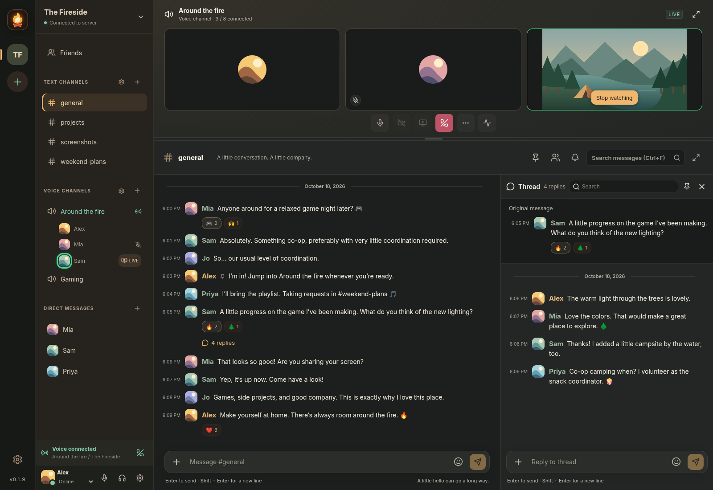

# Campfire

A cozy, self-hosted place for friends and communities to gather. Text, voice, video, and screen sharing—around your own digital campfire.

A place to catch up, share what you're working on, or just hang out together. Use Campfire in your browser or through the desktop app, with your community's own server at the center.



_A demo community with sample messages, avatars, an active voice channel, and a thread conversation._

## What you can do

- **Chat together:** organize text and voice channels into [collapsible categories](Docs/ChannelCategories.md) with shared role permissions, reply in threads, and message any server member directly from the member list, with unread message indicators.
- **Hop into a call:** join a voice channel or start a private voice or video call with up to eight people.
- **Share your screen:** show a game, a project, or whatever you're watching, and choose whose streams to follow.
- **Share the little things:** send files and images, react with emojis, and add your community's own custom emojis.
- **Decide together:** post a poll with up to ten answers, public or anonymous, and see the results once you've voted.
- **Pick up where you left off:** browse older messages, search conversations, pin useful messages, and return to your saved reading position.
- **Make it yours:** choose a nickname, profile picture, status, and light or dark appearance.
- **Keep things comfortable:** adjust [notification defaults and overrides](Docs/Notifications.md), audio devices, and individual call volumes.
- **Look after your community:** manage invitations, roles, and who can see or post in each channel.

## Join a campfire

Ask your host for their **server link**, or an **invite link** if their community is invite only. Paste it into the desktop app's server field, then create an account or sign in.

Links include the server's fingerprint, so the desktop app verifies it is talking to the real server from the very first connection. If you only have an address, the app shows the fingerprint once and asks you to confirm it; after that it refuses to connect if the server's identity ever changes.

You can also open the link in a browser. Browsers can't verify the server's own certificate automatically, so they show a security warning the first time; accept it only for a server you trust. The desktop app is the safer way to connect.

Visit [Releases](https://github.com/d3cr1pt0r/Campfire/releases) for available desktop downloads. The Windows installer and Linux AppImage support automatic client updates; portable Windows and Linux tarball downloads use manual updates. See [Desktop updates](Docs/DesktopUpdates.md) for release and upgrade details. Each community has its own accounts and conversations.

## Host your own

With Node.js 22.13 or newer and npm installed, run these commands from the project folder:

```bash
npm ci
npm run build
npm run server
```

By default, connections use HTTPS, with no domain or certificate setup. On first start the server creates its own key and prints:

- its **fingerprint** and a **server link** to share with your community;
- an **owner setup link**. Paste it into the desktop app to create the first account, which becomes the owner.

Set `PUBLIC_ADDRESS` to your server's public IP or hostname so the printed links are ready to share. New communities start in **Invite only** mode; manage invitations and copy invite links under **Settings → Server settings**.

Keep the server running for your community to stay connected. Your community's data is stored in `data/`, including the server's identity key in `data/identity/`. Back up the whole folder and keep it: without the identity key the server refuses to start, and creating a new identity means every desktop app refuses to connect until members get a new server link. Campfire doesn't encrypt stored messages and files, so use full-disk encryption and keep backups private. Messages are kept forever by default; to keep the database small, choose how long channels and direct messages keep them (or only their files), and how much space attachments may use, under **Settings → Server settings**. Pinned messages are always kept.

Already have a domain certificate or an HTTPS reverse proxy? See [.env.example](.env.example) for `TLS_CERT_FILE`/`TLS_KEY_FILE`, proxy mode and call connectivity settings.

For local development, `npm run server:dev` serves plain HTTP on `127.0.0.1` only; open **http://localhost:3001**.

To choose the transport for a terminal run, use:

```bash
npm run server:http    # Explicitly enable direct, unencrypted HTTP
npm run server:https   # Force HTTPS, overriding TLS=off in .env
```

These shortcuts override the transport setting in `.env` for that run. `npm run server` uses HTTPS by default unless configured otherwise in the environment.

To persist direct HTTP hosting in the environment instead, set both `TLS=off` and `ALLOW_INSECURE_HTTP=1`. In the **desktop app**, enter the full `http://address:port`, enable **Allow insecure HTTP for this server**, and accept the confirmation. Approval is saved for that exact address and port, including across restarts; uncheck it at sign-in to revoke it. The connected sidebar identifies insecure HTTP. Passwords, session tokens, messages and files are exposed in transit, and HTTP cannot verify the server identity. Bare addresses still default to HTTPS, and remote HTTP remains blocked in the browser client.

Prefer Docker? Run:

```bash
docker compose up --build -d
```

The fingerprint, server link and owner setup link appear in `docker compose logs campfire`. Community data and the server's identity are kept in a persistent Docker volume; back it up.

This version does not open databases from earlier versions; start it with a new data directory. See [database upgrades](REWORK.md#configuration-and-database-upgrades).

To rebuild a clean database while retaining accounts, passwords, roles, and server settings, see [save and restore the server setup](Docs/ServerSetupReset.md).

## Run the desktop app from source

With the dependencies installed, open another terminal in the project folder and run:

```bash
npm start
```

Paste your community's server link when prompted. The desktop app connects to a server; it does not start one for you.

## For contributors and hosts

- [Configuration](.env.example)
- [Architecture and upgrade guide](REWORK.md)
- [Implementation notes](IMPLEMENTATION.md)
- [Refresh the README showcase](Docs/screenshots/README.md) with `npm run showcase`.

To check a code change:

```bash
npm run check
npm run build
npm test
```
